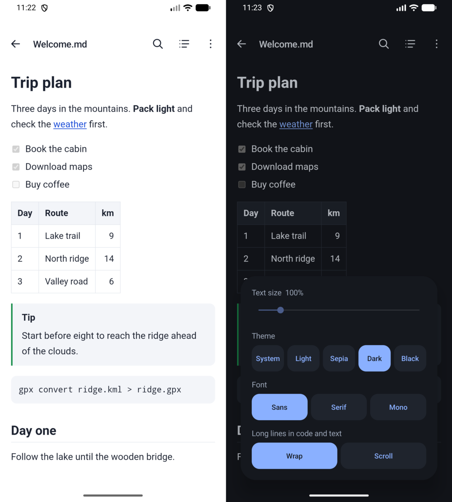

# Folio for Android

A small, simple reader for Markdown (`.md`) and text (`.txt`) files.
About 160 KB, no permissions, no internet access, no ads, no tracking.



[Download the latest APK](https://github.com/biteasier/folio-android/releases/latest) · [Folio for Mac](https://github.com/biteasier/folio)

## Features

- **Open files your way:** system file picker, Open with, Share, or add a folder and browse it.
- **GitHub-style Markdown:** headings, lists, task lists, tables, code, quotes, alerts, footnotes, links, simple HTML and local images.
- **Text files:** shown exactly as written, with wrapped or scrolling lines.
- **Easy to read:** light, sepia, dark and black themes, three fonts, adjustable text size.
- **Find your way:** contents list, find in file, recent files, and it remembers where you stopped reading.
- **Also:** view source, print or save as PDF, share, word count and reading time, right-to-left text.
- **Handles difficult files:** detects UTF-8 and UTF-16, lets you choose other encodings, and copes with large or damaged files.

Folio only reads. It never changes your files.

## Requirements

Android 11 or newer.

## Install

1. Download `Folio-1.0.0.apk` from [Releases](https://github.com/biteasier/folio-android/releases/latest) on your phone.
2. Open it and allow installing from that app if Android asks.
3. Open Folio and tap **Open file** or **Add folder**.

## Tips

- To make Folio your default reader, open a `.md` file in your file manager, choose Folio, then **Always**.
- To see images and follow links to other files, add the folder that contains them.
- Long-press a recent file or folder to remove it from the list.

## Privacy

Folio has no internet permission, so nothing can leave your phone. Images on websites are shown as links.
Scripts inside documents are blocked. Recent files and reading positions stay in the app's private storage.
When another app lets Folio read a file only once, Folio keeps a private copy (up to 2 MB) so you can reopen it.
Remove the file from Recent to delete the copy.

## Troubleshooting

| Problem | What to do |
|---|---|
| Folio is not offered for a `.md` file | Use Share, or open the file from inside Folio |
| Letters look wrong | More > Text encoding, then try the one for your language |
| Images are missing | Add the folder that contains them |
| File is shown as plain text | It is over the formatting limit, or use More > View as Markdown |
| Only part of a file is shown | Folio shows the first 10 MB |

## Not included

Editing, math, Mermaid diagrams, syntax highlighting and online images.

## Build

Needs JDK 17 and the Android SDK.

```bash
./gradlew testDebugUnitTest assembleRelease
```

Without the private release key, the build is signed with your local debug key.

## License

[MIT](LICENSE). Folio uses [commonmark-java](https://github.com/commonmark/commonmark-java) and
[autolink-java](https://github.com/robinst/autolink-java). Their licenses are in [NOTICE](NOTICE).
